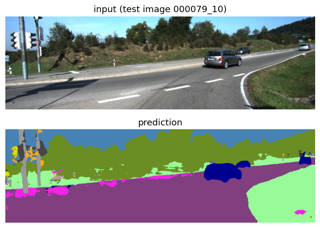

# KITTI Semantic Segmentation with UNet

A UNet in PyTorch, trained from scratch on the 200 labelled images of the KITTI semantic segmentation set. It predicts the 19 Cityscapes classes (road, car, sky, ...).


## Results

Scored on 40 held-out images from the KITTI training set, with mIoU over the 19 classes from one confusion matrix over the whole split.

| run | epoch | mIoU | pixel acc |
|---|---|---|---|
| v1, last checkpoint | 500 | 0.364 | 0.867 |
| v1, best checkpoint | 420 | 0.378 | 0.868 |
| v2, last checkpoint | 600 | 0.400 | 0.884 |
| v2, best checkpoint | 500 | 0.405 | 0.884 |

v1 is my first run (34 label IDs, images squashed to 256x512). v2 trains on the 19 classes directly, at 352x1184 with random crops and scaling, AdamW and a poly learning rate. The old training plots showed about 0.28 for v1. That came from a per-batch metric, not from the v1 model being worse.

[docs/RESULTS.md](docs/RESULTS.md) has how the numbers are made, per-class IoU, the commit and command behind each number, and timings.

Test image 000079_10 with the v2 model:



The median val image (input, ground truth, prediction):


`results/v2/` also has the best and worst val images and the training curves. The images directly in `results/` are from v1.

## Setup

```bash
python -m venv semantic_segmentation_venv
source semantic_segmentation_venv/bin/activate
pip install -r requirements.txt
```

I use Python 3.12 and an RTX 3060 Laptop GPU with 6 GB.

### Data

Download the KITTI semantic segmentation dataset and the devkit, and put them in `data/` like this:

```text
data/
 ├── data_semantics/
 │   ├── training/
 │   │   ├── image_2/        # RGB images
 │   │   └── semantic/       # ground truth masks
 │   └── testing/
 │       └── image_2/        # test images
 ├── devkit_semantics/       # KITTI devkit with the label definitions
 └── raw/
     └── 2011_09_26/2011_09_26_drive_0018_sync/   # raw drive, only for video_inference.py and the GIF
```

`data/` and `outputs/` are git-ignored. The 160/40 train/val split is saved in `splits/`.

## Usage

`run_v2.sh` runs the whole thing in order: unit tests, scoring the v1 checkpoints again, v2 training, evaluation, and the images above. Each step shows a progress bar and logs to `outputs/logs/`.

```bash
EPOCHS=600 bash run_v2.sh                 # everything
EPOCHS=600 bash run_v2.sh train eval      # only some steps
```

600 epochs took 4.5 hours on my GPU, so I run it inside tmux. If it stops, `bash run_v2.sh train` continues from `outputs/v2/checkpoints/last.pt`.

### Training

```bash
python train.py --run-name v2 --epochs 600
python train.py --resume outputs/v2/checkpoints/last.pt
```

Output goes to `outputs/<run-name>/`: `best.pt`, `last.pt`, `log.csv` and `curves.png`. `python train.py --help` lists the other options.

### Evaluation

```bash
python evaluate.py outputs/v2/checkpoints/best.pt --out-dir outputs/v2/eval
```

It writes a JSON with the scores, a per-class CSV and a summary CSV. It also works with the v1 checkpoints and reads the model type from the checkpoint.

### Inference

```bash
python inference.py --checkpoint outputs/v2/checkpoints/best.pt
python video_inference.py --checkpoint outputs/v2/checkpoints/best.pt
```

Without `--checkpoint` both use the v1 checkpoint from epoch 500.

### Tests

```bash
python -m unittest discover -s tests
```

## Limitations

- The val split is only 40 images, and they come from the KITTI training set. I have no KITTI test server score.
- The model is trained from scratch on 160 images. People, riders, bicycles and the rare vehicles are still mostly wrong.

## Acknowledgments

- KITTI dataset creators for providing the benchmark
- PyTorch team for the deep learning framework
- Albumentations library for data augmentation tools
