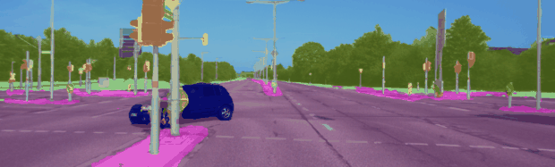
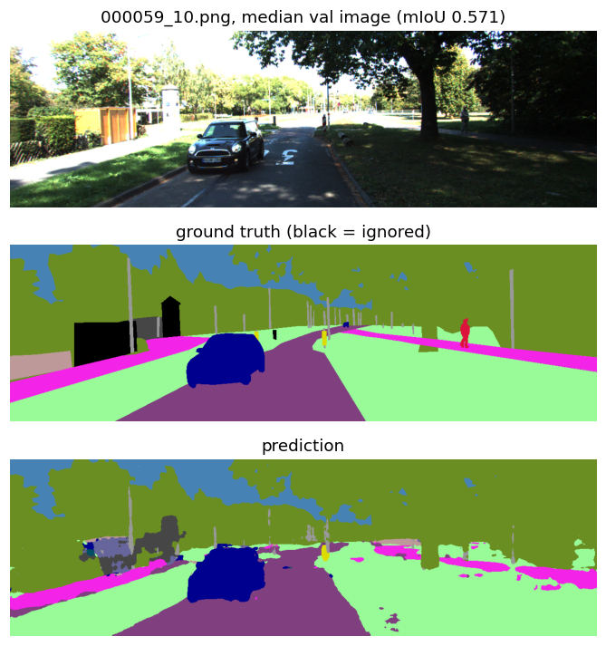

# KITTI Semantic Segmentation with UNet

A UNet trained from scratch on the KITTI semantic segmentation set, predicting the 19 Cityscapes classes.



## Results

mIoU over 19 classes on 40 held-out images from the KITTI training set.

| run | epoch | mIoU | pixel acc |
|---|---|---|---|
| v1 | 500 | 0.364 | 0.867 |
| v2 | 600 | 0.400 | 0.884 |
| v2 (best val) | 500 | 0.405 | 0.884 |

v1: 34 label IDs, 256x512. v2: 19 classes, 352x1184 with random crops, AdamW + poly LR. Per-class IoU and the exact commands are in [docs/RESULTS.md](docs/RESULTS.md).



## Setup

```bash
pip install -r requirements.txt
```

Put the KITTI data in `data/`:

```text
data/
 ├── data_semantics/{training,testing}/
 ├── devkit_semantics/
 └── raw/2011_09_26/2011_09_26_drive_0018_sync/   # only for video_inference.py and the GIF
```

## Usage

```bash
EPOCHS=600 bash run_v2.sh                       # tests, v1 re-score, train, eval, media
python train.py --run-name v2 --epochs 600      # or resume with --resume outputs/v2/checkpoints/last.pt
python evaluate.py outputs/v2/checkpoints/best.pt --out-dir outputs/v2/eval
python inference.py --checkpoint outputs/v2/checkpoints/best.pt
python -m unittest discover -s tests
```

## Limitations

- Only 40 val images, taken from the KITTI training set. No test-server score.
- Trained from scratch on 160 images, so people, riders and bicycles are mostly wrong.
