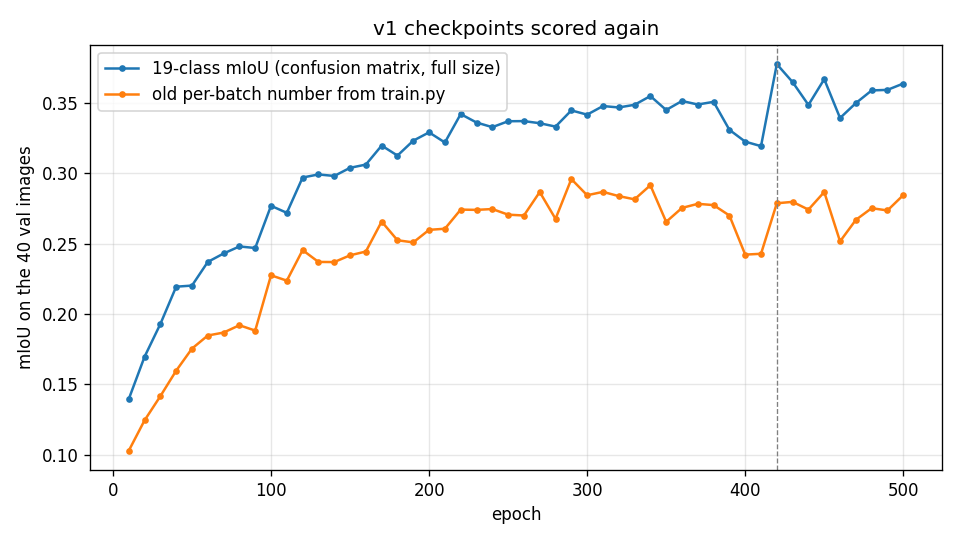
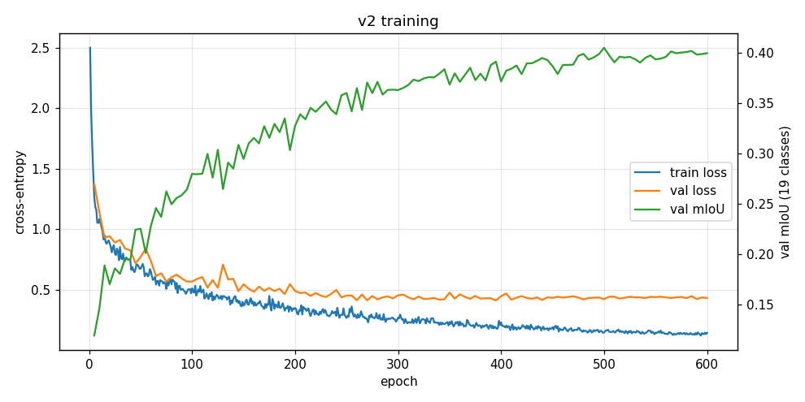

# Results

All numbers here come from the 40 validation images in `splits/val.txt`. Those images come out of the KITTI training set, because the KITTI test labels are not public. I did not submit anything to the KITTI test server.

## How I score a checkpoint

`evaluate.py` does this for every checkpoint:

- Run the model on each val image at the model's input size, upsample the logits back to the original image size (bilinear), and take the argmax.
- Map the ground truth from the 34 KITTI label IDs to the 19 Cityscapes trainIds. Everything else is 255 and ignored.
- Add every image to one 19x19 confusion matrix. IoU per class is TP / (TP + FP + FN). mIoU is the mean over the classes that have ground truth pixels in the split (all 19 do).
- For v1, which predicts 34 label IDs, the prediction goes through the same mapping. A pixel predicted as one of the ignored IDs counts as a miss for its true class.

The metric is tested in `tests/test_metrics.py` against a small example worked out by hand.

The "old per-batch" column is the number the old `train.py` printed: mIoU per batch of 12 images at 256x512, then averaged over batches. It gives lower numbers because classes that are rare in a batch pull the mean down. This is why the old plots show about 0.28.

## v1, scored again

v1 is the first run, trained with the old `train.py` on `main` (98b45a4): 34 label IDs, images squashed to 256x512, 500 epochs, a checkpoint every 10 epochs in `outputs/v1/checkpoints/`.

I scored all 50 checkpoints with the method above.

- commit: 5db5477
- command: `bash run_v2.sh rescore`, which runs `python evaluate.py outputs/v1/checkpoints/unet_epoch*.pt --out-dir outputs/v1_rescore` and `python plot_rescore.py`
- split: `splits/val.txt`, 40 images
- output: `results/v1_rescore/` (summary.csv has all 50 checkpoints, report.md has the full command)

| epoch | mIoU | pixel acc | old per-batch |
|---|---|---|---|
| 50 | 0.2201 | 0.7750 | 0.1753 |
| 100 | 0.2768 | 0.8339 | 0.2274 |
| 150 | 0.3038 | 0.8395 | 0.2416 |
| 200 | 0.3290 | 0.8423 | 0.2597 |
| 250 | 0.3369 | 0.8540 | 0.2705 |
| 300 | 0.3416 | 0.8586 | 0.2843 |
| 350 | 0.3449 | 0.8430 | 0.2654 |
| 400 | 0.3224 | 0.8322 | 0.2421 |
| 420 (best) | 0.3775 | 0.8681 | 0.2786 |
| 450 | 0.3668 | 0.8679 | 0.2866 |
| 500 (last) | 0.3637 | 0.8665 | 0.2844 |

So v1 was better than the old plots said: 0.364 at the last epoch, not 0.28.

## v2

What changed from v1:

- 19 trainIds instead of 34 label IDs, so the model doesn't spend output channels on classes that are never scored.
- Images resized to 352x1184, which keeps KITTI's aspect ratio, instead of being squashed to 256x512.
- Training on random 352x592 crops after a random scale of 0.75 to 1.5, plus flips and color changes.
- AdamW (lr 1e-3, weight decay 1e-4), 5 warm-up epochs, then poly decay (power 0.9) to 0, stepped every batch.
- Batch size 4, plain cross-entropy, fp32 with TF32 off.
- Same UNet as v1, trained from scratch. No pretrained weights and no v1 weights.
- Validation every 5 epochs with the method above. `best.pt` is kept when val mIoU goes up, `last.pt` every epoch.

The run:

- commit: 5db5477
- command: `EPOCHS=600 bash run_v2.sh`, which runs `python train.py --run-name v2 --epochs 600`
- split: `splits/train.txt` (160 images) for training, `splits/val.txt` for validation
- 600 epochs in 4 h 33 min on an RTX 3060 Laptop GPU (6 GB): 26.3 s per epoch on average, 4.2 s per validation pass
- output: `outputs/v2/` (checkpoints, log.csv, curves.png)

| epoch | 50 | 100 | 150 | 200 | 250 | 300 | 350 | 400 | 450 | 500 | 550 | 600 |
|---|---|---|---|---|---|---|---|---|---|---|---|---|
| val mIoU | 0.225 | 0.280 | 0.295 | 0.327 | 0.360 | 0.363 | 0.368 | 0.372 | 0.387 | 0.405 | 0.394 | 0.400 |

After about epoch 450 it moves around between 0.39 and 0.405, so the peak at 500 is partly noise from having only 40 val images.

## v1 against v2

Both scored with the same method on the same 40 images. The v2 numbers are from `bash run_v2.sh eval` at commit 805558c, which runs `python evaluate.py outputs/v2/checkpoints/best.pt outputs/v2/checkpoints/last.pt --out-dir outputs/v2/eval`. Running it from 5db5477 gave the same best.pt numbers.

| run | checkpoint | epoch | mIoU | pixel acc | commit |
|---|---|---|---|---|---|
| v1 | outputs/v1/checkpoints/unet_epoch420.pt (best) | 420 | 0.3775 | 0.8681 | 5db5477 |
| v1 | outputs/v1/checkpoints/unet_epoch500.pt (last) | 500 | 0.3637 | 0.8665 | 5db5477 |
| v2 | outputs/v2/checkpoints/best.pt | 500 | 0.4051 | 0.8836 | 805558c |
| v2 | outputs/v2/checkpoints/last.pt | 600 | 0.3997 | 0.8841 | 805558c |

The "best" rows are picked on the same 40 images they are scored on, so they are a bit optimistic. The last-epoch rows don't have that problem: 0.364 for v1 against 0.400 for v2.

Per class IoU:

| class | val GT pixels | v1 epoch 420 | v1 epoch 500 | v2 epoch 500 | v2 epoch 600 |
|---|---|---|---|---|---|
| road | 3,883,483 | 0.858 | 0.852 | 0.858 | 0.866 |
| sidewalk | 881,651 | 0.431 | 0.405 | 0.497 | 0.496 |
| building | 1,925,874 | 0.681 | 0.688 | 0.702 | 0.706 |
| wall | 95,653 | 0.207 | 0.210 | 0.228 | 0.207 |
| fence | 250,819 | 0.111 | 0.085 | 0.203 | 0.191 |
| pole | 252,865 | 0.365 | 0.369 | 0.440 | 0.442 |
| traffic light | 51,221 | 0.475 | 0.494 | 0.558 | 0.560 |
| traffic sign | 151,412 | 0.203 | 0.200 | 0.355 | 0.425 |
| vegetation | 5,734,951 | 0.867 | 0.864 | 0.883 | 0.883 |
| terrain | 1,837,436 | 0.760 | 0.742 | 0.773 | 0.772 |
| sky | 1,754,595 | 0.919 | 0.919 | 0.929 | 0.931 |
| person | 23,441 | 0.023 | 0.036 | 0.080 | 0.067 |
| rider | 8,284 | 0.000 | 0.000 | 0.000 | 0.001 |
| car | 1,100,913 | 0.751 | 0.732 | 0.789 | 0.774 |
| truck | 37,425 | 0.017 | 0.019 | 0.125 | 0.075 |
| bus | 1,208 | 0.273 | 0.235 | 0.213 | 0.137 |
| train | 647 | 0.000 | 0.000 | 0.002 | 0.002 |
| motorcycle | 708 | 0.215 | 0.057 | 0.000 | 0.000 |
| bicycle | 9,856 | 0.015 | 0.003 | 0.062 | 0.062 |

v2 is better on the thin and small things: poles, signs, traffic lights, fences. That fits with the higher input resolution. Bus, train and motorcycle have under 1,300 ground truth pixels each in the whole val split, so their IoU is close to random and v1's 0.215 for motorcycle doesn't mean much. People, riders and bicycles are still bad in both runs. There are very few of them in 160 training images.

I changed several things at once between v1 and v2, so I can't say how much of the gain comes from each one.

## Speed

From `bash run_v2.sh bench` at commit 805558c (output in `outputs/bench.md`). Training steps are batch 4 at 352x592 on real data, 10 warm-up steps and then 50 timed ones. Each row adds one change to the row above it.

| setting | ms/step | peak GPU memory |
|---|---|---|
| decode PNGs every step (old behaviour) | 669 | 4.71 GiB |
| + images cached in RAM | 680 | 4.71 GiB |
| + pin_memory and non_blocking copies | 680 | 4.71 GiB |
| + channels_last | 791 | 4.70 GiB |
| + fused AdamW | 789 | 4.70 GiB |
| + torch.compile | 825 | 4.46 GiB |

The step time is all GPU compute. Loading data doesn't matter here, and channels_last and torch.compile made it slower on this GPU. In an earlier try the first five rows were all between 716 and 727 ms, so differences of about 10 ms are noise. v2 uses the defaults: images cached in RAM and pinned memory on, the rest off.

Other checks from the same run:

| check | result |
|---|---|
| confusion matrix for the 40 val images, CPU | 126.2 ms |
| confusion matrix for the 40 val images, GPU | 27.8 ms |
| v1 setup (34 classes, batch 8, 256x512, fp32, cudnn.benchmark off) | out of memory |
| v2 setup (19 classes, batch 4, 352x592, fp32) | 686 ms/step, 4.77 GiB |
| same with bf16 autocast | 309 ms/step, 3.05 GiB |
| batch 8 with bf16 | out of memory |

bf16 would be about 2.2x faster, but I kept v2 in fp32 so the precision is the same as v1. `train.py --bf16` is there if I want it later.

## Limitations

- 40 val images is small. Differences of 0.01 mIoU are within the noise you see between neighbouring checkpoints.
- The val images come from the KITTI training set. There is no test-server score.
- 160 training images and no pretrained encoder. A pretrained backbone would very likely do a lot better. I haven't tried it yet.
